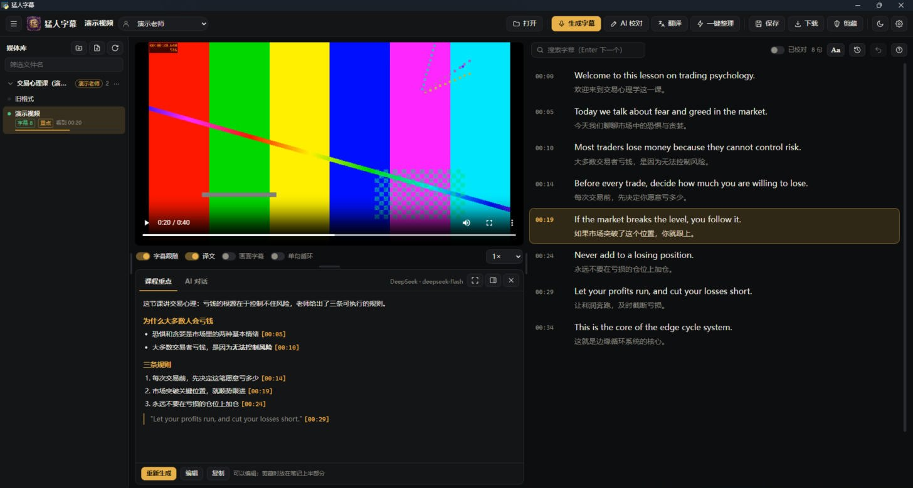

# 猛人学习（Mengren Learning）

> 原名「猛人字幕」，1.6 版起改名为「猛人学习」。

一个 Windows 上的学习资料整理软件：
- **视频 / 音频课程**：准确识别字幕，按老师的术语表校对，结合课件和板书画面提炼课程重点；剪藏到 Obsidian，得到一篇可以直接用来做知识整理或「蒸馏」的笔记：上半部分是课程重点，下半部分是完整的带时间戳的字幕。
- **书籍和文档**（PDF、Word、TXT、Markdown）：按章做来源级整理，文字层和原页面一起看，每条标书上的页码，最后生成全书总览，剪藏到 Obsidian。



## 下载和安装

1. 到 [Releases](https://github.com/longpeng1413/mengren-learning/releases) 下载最新的 `mengren-learning-版本号-windows.zip`，解压到任意文件夹（不要放在 C:\Program Files 这类需要管理员权限的地方）。
2. 安装 ffmpeg（用来读取和转换音视频）。在「终端」里运行：
   ```
   winget install Gyan.FFmpeg
   ```
   也可以把 `ffmpeg.exe` 和 `ffprobe.exe` 直接放进软件文件夹。
3. 双击 `猛人学习.exe`。整个文件夹要放在一起，不能只拷 exe。

从「猛人字幕」升级：设置、老师档案、媒体库会自动搬到新名字下；视频旁边旧的 `.猛人字幕.json` 照样能读，下次保存时自动改成 `.猛人学习.json`。

运行环境：Windows 10 / 11（64 位）。界面用的是系统自带的 Edge WebView2，Windows 11 已内置；Windows 10 如果打不开，请先安装 [WebView2 运行时](https://developer.microsoft.com/microsoft-edge/webview2/)。

## 第一次使用

1. 点右上角的齿轮打开「设置」，至少设置一个**字幕识别服务**和一个 **AI 服务**，每个服务都有「测试连接」按钮：
   - 中文课程识别：豆包语音（火山引擎）或硅基流动；
   - 英文课程识别：OpenAI Whisper；
   - AI 校对、翻译、课程重点、对话：ChatGPT 账号登录、Claude、Gemini、DeepSeek、豆包大模型、硅基流动、OpenAI 任选。
2. 在「设置 → Obsidian」里选择你的库和要存放的文件夹。
3. 在「设置 → 老师与术语表」里给常听的老师建一份术语表（可选，但对识别准确率帮助很大）。
4. 在左侧媒体库点「＋文件夹」，把课程文件夹加进来，点哪个看哪个。

## 典型用法

1. **建老师档案**：给每位老师建一份术语表；整份术语说明文档可以用「从文件导入…」放进「术语说明」。
2. **加媒体库**：把一位老师的课程文件夹加进来；在文件夹的「⋯」菜单里绑定这位老师，里面的视频会自动用他的术语表。
3. **一键整理**：点开一节课，点「一键整理」，按顺序执行：
   - 生成字幕（术语表会传给识别服务）；
   - AI 按术语表校对（拿不准的句子标成「存疑」，不乱改）；
   - 找关键帧、写画面记录（课件、板书、老师手绘，需要能看图的 AI）；
   - 用画面复核存疑句：截下每句存疑句说话时的画面（常有烧录字幕），能确认的改正，看不清的留给你回听；
   - 翻译（英文课程）；
   - 生成课程重点，再自动「查漏补缺」。
4. **人工检查**：点字幕栏上方的「存疑」逐句回听；在右边字幕上直接修改，改完自动保存；检查完打开「已校对」。
5. **剪藏**：笔记存到 Obsidian 库的 `猛人学习/老师名/课程名.md`（文件夹可以设置）。

## 书籍和文档

1. 在媒体库里点 PDF 或 Word（TXT / Markdown 用「打开」）。扫描或拍照的 PDF 请先用 WPS 做 OCR。
2. 左边看原文，右边核对：书名、作者、「书上第 1 页是 PDF 第几页」（软件会自动认书上的页码），以及章节分得对不对——可以直接改章名和起止页，或者点「AI 读目录分章」（扫描书的章名常被 OCR 拆坏，这时用它）。前言、目录这类不编号，正文章节从 01 开始。
3. 勾选章节点「整理选中的章节」，或「整理全部未整理的」。每章：
   - 文字层负责读正文；有图、表、公式的页截成图片一起交给 AI 看（需要能看图的 AI）；
   - 按固定栏目整理（本章主题、核心内容、概念、观点、方法、案例 / 图表、知识框架、关键结论、页码索引、需要人工确认、OCR 修正、一句话概括）；
   - 每条标书上的页码（P42），书上没有页码时写「PDF 第 X 页」；点页码，左边就跳到那一页；
   - PDF 旁边有同名的 Word（WPS 做 OCR 后导出的）时，自动拿它当正文参考：Word 文字一般比 PDF 文字层准，页码和图表仍以 PDF 为准；
   - 整理完自动查漏：一次都没被引用的页，让 AI 再看一遍、补进对应小节；
   - 再「回页面核对」：「需要人工确认」里提到的页截图给 AI 看，能看清的直接改正、记进「已确认的 OCR 修正」，真正看不清或原书本身有歧义的才留给你；
   - 原书图示非必要不用，每章最多 2 张，按位置裁剪、压缩。
4. 点「全书总览」生成 `00、全书总览`，再点「剪藏」：写进 Obsidian 的 `《书名》作者/` 文件夹（`00、全书总览.md`、`01、第一章 ….md`、`image/`），笔记状态是「待审计」。
5. 可以在「设置 → Obsidian」里关联知识库里的《外部书籍与文档整理规范》，整理时以它为准。

## 功能

- **媒体库**（左侧，可以收起，宽度可以拖动）：
  - 可以加多个文件夹（含子文件夹）和单个文件，点哪个看哪个；
  - 每个视频会标出：有没有字幕、有没有重点、是否已校对、是否已剪藏，以及看到哪里。
- **续播**：每个视频都会记住播放进度，再打开时从上次的位置接着播。
- **字幕**：
  - 点文字跳转，并可直接编辑；点时间只跳转；
  - 鼠标移到某句上，可以对齐时间、拆分、合并、删除，都可以撤销；
  - 可以搜索，可以单句循环，可以在画面上叠加字幕；
  - 重新识别、清空、恢复之前会自动存历史版本（最多 5 份），随时可以换回来。
- **文字设置（字幕栏右上角的「Aa」）**：字号、行距、句间距、字幕栏宽度、字体和主题。
- **布局**：视频、字幕、AI 区之间的分隔条都可以拖动；AI 区可以放在视频下方，也可以移到最右侧当侧边栏，还可以一键放大或隐藏。
- **课程重点**：不套固定栏目，按老师这节课实际的知识体系和逻辑框架来组织，可以调整顺序、合并同一件事。只写老师讲过的内容，不补充、不推测、不评价；定义、口诀、规则、数字照录，每个要点标时间戳，拿不准的标「存疑」。老师的自述（经历、学员数量、出版、原创说法）和课程安排也会保留并注明。要求可以改，每位老师也可以单独设一份。
- **画面（视觉资料）**：AI 区的「画面」页点「找关键帧」：
  - 软件每隔约 15 秒截一张候选画面（避开老师挡住屏幕的那几秒），老师说「大家请看」时也截一张；
  - 能看图的 AI 一批批挑出有内容的画面（新的一页课件、写得更满的板书、手绘曲线），同一页只留最完整的一张；
  - 再给每张写「画面记录」：照录课件文字和板书，分清哪些是课件原有的、哪些是老师现场写画的，抄下画面上的字幕；
  - AI 校对、课程重点、查漏和对话都会参考画面记录；课程重点里只来自画面的内容写成「画面显示……」；
  - 插图非必要不用：只有文字确实说不清的（手绘曲线形状、K 线标注位置、复杂结构图）才插，整节课最多 3 张，图片缩到 960 宽并压缩，让知识库尽量小；
  - 看到重要画面可以点「截取当前画面」；画面记录可以自己改。25 分钟的课大约 3 分钟。
- **查漏补缺**：课程重点生成后，AI 再对照完整字幕检查一遍，把漏掉的内容补进对应小节；界面上显示字幕被引用的比例和没有出处的时间段。
- **来源情况**：字幕提前结束、最后一句没说完、视频结尾损坏，软件会自己检查出来写进笔记，不让 AI 补写。
- **存疑句**：AI 校对时读起来不通、疑似听错的句子，用橙色标出并写明原因；点「存疑」逐句跳过去单句循环回听。
- **AI 对话**：AI 读过全部字幕和术语表，回答里的时间点可以点击跳转。
- **下载字幕**：TXT 或 SRT，可以选中英对照、只要原文或只要中文。
- **剪藏到 Obsidian**：属性（老师、系列、时长、是否校对、状态）→ 课程重点（含插图）→ 完整带时间戳的字幕（存疑句会标出）→ 画面记录。插图复制到笔记旁边的 `image` 文件夹。同一节课再次剪藏会更新原来的笔记，即使你在 Obsidian 里移动或改名了；笔记里的 status 会保留。文件名格式可以设置。
- **主题**：墨黑（默认）、帝王紫、深灰、浅色，另有 7 种强调色。
- **换电脑**：设置可以导出成一个文件，在新电脑上导入。

## 术语表

术语表每行一条，有三种写法：

```
峰级, 峰级线, 破级          ← 专用术语（传给识别服务当热词）
风级, 风机 => 峰级          ← 常见识别错误：交给 AI 结合上下文判断，不直接替换
托破旋 =>! 拓扑学           ← 确定不会误伤的：识别完直接替换
```

单字或常用词（比如「分 => 峰」）一定不要加感叹号，否则「部分」也会被改成「部峰」。整份术语说明文档放在「术语说明」框里，只给 AI 参考，不传给识别服务。

**推荐：直接关联 Obsidian 里的术语表文件。** 在老师档案里点「关联术语表文件」选中那份 MD，软件每次都读最新内容：
- 小节里写了「正确写法 / 标准写法」的词、`--hotwords "…"` 里的热词，当作术语传给识别服务；
- 表头含「ASR / 误识 / 识别」的表格（左列错写、右列正确写法），当作识别错误参考，只交给 AI 结合上下文判断；
- 整份文件给 AI 当术语说明。

以后只需要在 Obsidian 里改术语表。

| 环节 | 做法 |
|---|---|
| 识别（豆包） | 术语作为热词传给豆包；没有术语时，传老师和课程背景 |
| 识别（OpenAI Whisper） | 术语写进提示词 |
| 识别（硅基流动） | 接口读不了术语表，靠后面的 AI 校对 |
| 识别完成后 | 只有 `错写 =>! 正确` 的对照直接替换 |
| AI 校对 | 参考术语表、识别错误对照和术语说明，结合上下文只修正识别错误，不改写句子；改过的句子用绿色下划线标出，可以撤销 |
| 翻译、课程重点、对话 | 都会参考术语表和老师背景 |

## 字幕识别服务

| 服务 | 说明 |
|---|---|
| 豆包语音（火山引擎） | 中文最准，带逐句时间戳。支持录音文件识别极速版（默认）、流式识别 1.0 / 2.0、标准版 1.0 / 2.0 和闲时版（后两种需要火山引擎对象存储 TOS）。新版控制台用 API Key，旧版用 App ID + Access Token |
| 硅基流动 | 有 Qwen3-ASR、SenseVoice 等模型。只返回文字、不返回时间，软件会按停顿切成短段，时间可能差几秒 |
| OpenAI | whisper-1 带逐句时间戳，适合英文。国内访问需要在「设置 → 网络代理」里填代理 |

## AI 服务

| 服务 | 怎么接入 | 适合做什么 |
|---|---|---|
| ChatGPT | 用 ChatGPT 账号登录（Plus / Pro / Business），调用套餐里的 Codex 额度，不花 API 费用 | 课程重点、对话 |
| Claude | API Key。Anthropic 不允许第三方软件用 Claude.ai 账号登录 | 课程重点 |
| Gemini | AI Studio 的 API Key（有免费额度）。Google 不允许第三方软件借用账号登录 | 通用 |
| DeepSeek | API Key | 校对、翻译，便宜 |
| 豆包大模型（火山方舟） | API Key，和「豆包语音」是两个不同的服务 | 中文 |
| 硅基流动 | 和识别用同一个 Key | 校对、翻译 |
| OpenAI | API Key | 通用 |

课程重点和对话、AI 校对、翻译、画面识别可以在「设置 → 任务用哪个 AI」里分别选用不同的服务。画面识别要能看图：ChatGPT 账号、Claude、Gemini、OpenAI 都可以，豆包大模型和硅基流动要选视觉模型，DeepSeek 不能看图。

ChatGPT 账号登录用的是 OpenAI Codex 命令行工具的登录方式，不是 OpenAI 为本软件提供的正式接口，以后可能会变化。

## 数据和隐私

| 内容 | 位置 | 能不能删 |
|---|---|---|
| 字幕、课程重点、画面记录、对话记录、字幕历史版本 | 视频旁边的 `视频名.mp4.猛人学习.json` | 删了字幕就没了 |
| 书籍的章节整理稿和全书总览 | 文档旁边的 `书名.pdf.猛人学习.json` | 删了整理结果就没了 |
| 设置、API 密钥、ChatGPT 登录、老师档案、媒体库、播放进度 | `%APPDATA%\猛人学习\`（都很小） | 不要删；换电脑用「导出设置」 |
| 缓存（转换后的视频、抽出的音频、关键帧截图） | 软件文件夹里的 `缓存（可随时删除）` | 可以随时删除（截图需要时会重新截） |
| 日志 | 软件文件夹里的 `日志（可随时删除）` | 可以随时删除 |

- 软件没有服务器，不收集任何数据。音频只会发给你选择的识别服务，字幕只会发给你选择的 AI 服务。
- API 密钥只保存在本机，日志里不记录密钥。
- 缓存自动清理：抽出的音频保留 3 天，转换后的视频最多 5GB，关键帧截图 30 天没用过就删。日志最多 4 个文件、每个 2MB。缓存和日志的位置可以在「设置 → 关于与数据」里更改。

## 从源码运行

需要 Python 3.12 以上（开发用的是 3.14）和 ffmpeg。

```bat
python -m venv .venv
.venv\Scripts\python -m pip install -r requirements.txt

rem 运行
.venv\Scripts\python app\main.py

rem 后台测试（不联网，会用 ffmpeg 生成测试视频）
.venv\Scripts\python tests\test_backend.py

rem 界面测试（会弹出一个窗口自动操作，1–2 分钟后关闭；加 --exe 测打包好的版本）
.venv\Scripts\python tests\run_ui_test.py

rem 打包：输出到 dist-next；关掉正在运行的猛人学习后，双击「更新到新版.bat」换进 dist
.venv\Scripts\python build.py
```

目录结构：

- `app\main.py`：程序入口，负责开窗口和关闭流程；
- `app\bridge.py`：界面调用后台功能的接口；
- `app\core\`：
  - `asr.py`：字幕识别；
  - `llm.py`：AI 调用（翻译、校对、课程重点、对话）；
  - `codex_auth.py`：ChatGPT 账号登录；
  - `library.py`：媒体库；
  - `doc.py`：字幕文件、导出和剪藏；
  - `media.py`：ffmpeg 处理；
  - `frames.py`：关键帧和画面记录；
  - `book.py`：书籍和文档（读取 PDF / Word / 文本、分章、页码、整理、全书总览、剪藏）；
  - `config.py`：设置、老师档案、播放进度和存放位置；
  - `cache.py`、`log.py`、`jobs.py`：缓存清理、日志、后台任务；
- `app\web\`：界面（HTML、CSS、JavaScript）。

技术说明：界面用 [pywebview](https://pywebview.flowrl.com/)（Edge WebView2）显示，以 `file://` 加载，通过 pywebview 的 js_api 和 Python 后台通信，不开本地网络端口。这样做是因为有些安全软件和代理工具会干扰本机回环连接（127.0.0.1）。

## 致谢

字幕识别的切段方式、豆包和 OpenAI 兼容接口的调用、ChatGPT 账号登录的做法，参考了 [乔木剪藏 qiaomu-clipper](https://github.com/joeseesun/qiaomu-clipper)。

## 许可

[MIT](LICENSE)
